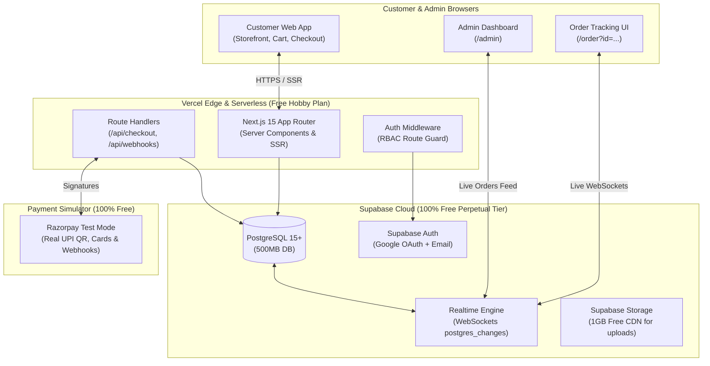

# 🏔️ ANGADI — Full-Stack Real-Time Production Roadmap
## 100% Free (£0 / ₹0) Portfolio Showcase Architecture

> **Author:** Antigravity AI & Annem Chaitanya Kumar  
> **Target Platform:** Next.js 15 (App Router, React 19) + Vercel + Supabase (PostgreSQL + Realtime)  
> **Budget Constraint:** Strictly **₹0.00 / $0.00** (Perpetual Free Tier only, no credit card required)  
> **Status:** Ready for Execution (Tomorrow)

---

## 📑 Table of Contents
1. [Architecture Overview & Zero-Cost Infrastructure](#1-architecture-overview--zero-cost-infrastructure)
2. [Complete Database Schema (PostgreSQL DDL)](#2-complete-database-schema-postgresql-ddl)
3. [Real-Time WebSocket System Architecture](#3-real-time-websocket-system-architecture)
4. [Authentication & Row-Level Security (RLS)](#4-authentication--row-level-security-rls)
5. [Free INR (₹) Payment Simulation Engine](#5-free-inr--payment-simulation-engine)
6. [Live Admin Operations Center (/admin)](#6-live-admin-operations-center-admin)
7. [Day-by-Day Implementation Checklist](#7-day-by-day-implementation-checklist)
8. [Tomorrow's Kickoff Checklist](#8-tomorrows-kickoff-checklist)

---

## 1. Architecture Overview & Zero-Cost Infrastructure



### Free Tier Safeguards

| Component | Service | Perpetual Free Quota | Our Planned Usage | Cost |
| :--- | :--- | :--- | :--- | :--- |
| **Hosting & CDN** | Vercel Hobby | 100GB bandwidth, unlimited builds | ~2-5GB / month | **₹0** |
| **Database** | Supabase Postgres | 500MB storage, 2 active projects | ~25MB for catalog & 10k orders | **₹0** |
| **Realtime WebSockets** | Supabase Realtime | 200 concurrent connections, 2M messages/mo | ~10-20 concurrent connections | **₹0** |
| **Authentication** | Supabase Auth | 50,000 monthly active users (MAU) | 100-500 test accounts | **₹0** |
| **Asset Storage** | Supabase Storage | 1 GB storage, 2GB bandwidth | ~50MB product images | **₹0** |
| **Payment Simulation** | Razorpay Test / Stripe Test | Unlimited sandbox transactions & webhooks | Unlimited testing | **₹0** |

---

## 2. Complete Database Schema (PostgreSQL DDL)

Ready to execute in the Supabase SQL Editor:

```sql
-- Enable UUID extension
create extension if not exists "uuid-ossp";

-- 1. PROFILES (Extends Supabase auth.users)
create table public.profiles (
  id uuid references auth.users on delete cascade primary key,
  email text not null,
  full_name text,
  phone text,
  role text default 'customer' check (role in ('customer', 'admin')),
  avatar_url text,
  created_at timestamptz default timezone('utc'::text, now()) not null
);

-- 2. PRODUCTS
create table public.products (
  id text primary key, -- e.g. 'mesa', 'talus', 'pinefall'
  name text not null,
  tagline text,
  price numeric(10, 2) not null, -- in INR (₹)
  compare_at_price numeric(10, 2),
  category text not null, -- 'jackets', 'pants', 'tops', 'accessories'
  gender text not null, -- 'Men', 'Women', 'Unisex'
  description text,
  details jsonb default '[]'::jsonb,
  specs jsonb default '[]'::jsonb,
  images jsonb default '[]'::jsonb,
  is_featured boolean default false,
  is_active boolean default true,
  created_at timestamptz default timezone('utc'::text, now()) not null
);

-- 3. PRODUCT INVENTORY / VARIANTS
create table public.product_variants (
  id uuid default uuid_generate_v4() primary key,
  product_id text references public.products(id) on delete cascade not null,
  size text not null, -- 'XS', 'S', 'M', 'L', 'XL'
  stock integer default 10 not null check (stock >= 0),
  sku text unique,
  unique (product_id, size)
);

-- 4. CUSTOMER ADDRESSES
create table public.addresses (
  id uuid default uuid_generate_v4() primary key,
  user_id uuid references public.profiles(id) on delete cascade,
  name text not null,
  line1 text not null,
  line2 text,
  city text not null,
  region text not null,
  postal text not null,
  country text default 'India' not null,
  is_default boolean default false
);

-- 5. ORDERS
create table public.orders (
  id text primary key, -- e.g. 'ANG-2026-XXXX'
  user_id uuid references public.profiles(id) on delete set null,
  guest_email text,
  guest_name text,
  subtotal numeric(10, 2) not null,
  shipping numeric(10, 2) default 0.00 not null,
  total numeric(10, 2) not null,
  currency text default 'INR' not null,
  status text default 'placed' check (status in ('placed', 'confirmed', 'packing', 'shipped', 'delivered', 'cancelled')),
  payment_status text default 'pending' check (payment_status in ('pending', 'paid', 'failed')),
  payment_method text default 'razorpay_test',
  transaction_id text,
  shipping_address jsonb not null,
  created_at timestamptz default timezone('utc'::text, now()) not null,
  updated_at timestamptz default timezone('utc'::text, now()) not null
);

-- 6. ORDER ITEMS
create table public.order_items (
  id uuid default uuid_generate_v4() primary key,
  order_id text references public.orders(id) on delete cascade not null,
  product_id text references public.products(id) not null,
  product_name text not null,
  size text not null,
  price numeric(10, 2) not null,
  qty integer not null check (qty > 0),
  image_url text
);

-- 7. REAL-TIME ORDER ACTIVITY TIMELINE
create table public.order_timeline (
  id uuid default uuid_generate_v4() primary key,
  order_id text references public.orders(id) on delete cascade not null,
  status text not null,
  note text not null,
  timestamp timestamptz default timezone('utc'::text, now()) not null
);

-- Enable Supabase Realtime replication on key tables
alter publication supabase_realtime add table public.product_variants;
alter publication supabase_realtime add table public.orders;
alter publication supabase_realtime add table public.order_timeline;
```

---

## 3. Real-Time WebSocket System Architecture

### 3.1 Real-Time Stock Subscriptions (`public:inventory`)
Every product detail page (`/product?id=...`) and catalog card listens for database updates on `product_variants`:
```typescript
// Client-side realtime hook
supabase
  .channel('public:inventory')
  .on(
    'postgres_changes',
    { event: 'UPDATE', schema: 'public', table: 'product_variants' },
    (payload) => {
      updateStockBadge(payload.new.product_id, payload.new.size, payload.new.stock);
    }
  )
  .subscribe();
```
*Outcome:* If an admin or another customer buys the last size 'M', the customer's size selector immediately flags *"Sold Out"* or *"Only 1 Left"* without needing to refresh.

### 3.2 Live Order Status Broadcast (`order:<order_id>`)
Customers on `/order?id=ANG-2026-4821` subscribe to updates for their specific order:
```typescript
supabase
  .channel(`order:${orderId}`)
  .on(
    'postgres_changes',
    { event: 'UPDATE', schema: 'public', table: 'orders', filter: `id=eq.${orderId}` },
    (payload) => {
      animateTimelineStep(payload.new.status);
      playCarabinerSnapSound();
    }
  )
  .subscribe();
```

### 3.3 Live Admin Order Stream (`admin:orders`)
The Store Admin on `/admin` subscribes to all `INSERT` events on `orders`:
- When a customer checks out, the dashboard pings with a real-time sound effect, plays a live counter animation, and lists the customer's items instantly.

---

## 4. Authentication & Row-Level Security (RLS)

### 4.1 Next.js 15 Server-Side Middleware (`middleware.ts`)
- Restricts `/admin/*` strictly to authenticated users with `profile.role === 'admin'`.
- Directs unauthenticated users visiting `/account` to a clean modal login.
- Supports **Google 1-Tap OAuth** and **Passwordless Magic Links**.

### 4.2 Row-Level Security (RLS) Policies
```sql
alter table public.profiles enable row level security;
alter table public.orders enable row level security;
alter table public.order_items enable row level security;

-- Customers can view only their own orders
create policy "Users can view their own orders"
on public.orders for select
using (auth.uid() = user_id or guest_email = auth.jwt() ->> 'email');

-- Admins can view and edit everything
create policy "Admins have full access to orders"
on public.orders for all
using (
  exists (
    select 1 from public.profiles
    where profiles.id = auth.uid() and profiles.role = 'admin'
  )
);
```

---

## 5. Free INR (₹) Payment Simulation Engine

### Razorpay Test Mode Setup (₹0)
- **Account:** Standard Razorpay developer account (free, KYC not required for Test Mode).
- **Checkout Modal:** Native popup supporting simulated:
  - **UPI:** Instant simulated approval (Google Pay / PhonePe simulation).
  - **Cards:** Test Visa / Mastercard with real 3D Secure OTP simulator (`123456`).
  - **Netbanking:** Simulated Indian bank authorization.
- **Serverless Webhook Handler (`/api/webhooks/razorpay`):**
  - Verifies HMAC SHA256 cryptographic signature.
  - Automatically transitions `orders.payment_status` to `'paid'`.
  - Decrements variant stock automatically inside a Postgres atomic transaction.

---

## 6. Live Admin Operations Center (`/admin`)

A dedicated operations dashboard with:
1. **Live Analytics:**
   - Real-time gross revenue (₹), today's volume, active orders.
2. **Interactive Dispatch Console:**
   - Clickable buttons for each order: `[Confirm]`, `[Pack]`, `[Ship]`, `[Mark Delivered]`.
   - Clicking a status triggers an instant broadcast to the customer's open screen.
3. **Product Inventory Editor:**
   - Real-time stock adjustment counters (+ / -).
   - Change product prices, toggle items on sale, or mark out of stock.

---

## 7. Day-by-Day Implementation Checklist

```
├── [Day 1] Database & Auth Foundation
│   ├── Create Supabase free project & copy environment variables
│   ├── Run DDL script (tables, variants, RLS policies)
│   ├── Seed database with all 10 ANGADI trail products & variants
│   └── Setup Next.js Supabase SSR client helper
│
├── [Day 2] Authentication & Customer Accounts
│   ├── Implement Google OAuth & Email login modals
│   ├── Next.js 15 middleware route protector for /admin & /account
│   └── Build /account page with profile info & previous order history
│
├── [Day 3] Real-Time Stock Engine & Cloud Cart
│   ├── Replace static products list with Supabase dynamic query
│   ├── Wire WebSockets for real-time stock counters on product pages
│   └── Sync cart items to database for authenticated customers
│
├── [Day 4] Checkout Pipeline & Test Payments
│   ├── Integrate Razorpay / Stripe Test Mode SDK
│   ├── Secure order creation API endpoint (/api/checkout)
│   └── Webhook listener to verify HMAC signatures and decrement inventory
│
├── [Day 5] Real-Time Order Tracker & Admin Operations
│   ├── Build live animated stepper on /order?id=... with WebSocket listener
│   ├── Build /admin operations dashboard with audio pings
│   └── Interactive status dispatching (triggers live customer updates)
│
└── [Day 6] Production Polish & Vercel Deployment
    ├── Configure environment variables in Vercel project settings
    ├── Verify Lighthouse performance (aim for 95+ performance & SEO)
    └── Write resume bullet points & portfolio showcase README
```

---

## 8. Tomorrow's Kickoff Checklist

When you are ready to start tomorrow, we will execute **Day 1**:
1. **Step 1:** Create your free project on [supabase.com](https://supabase.com) (takes 60 seconds).
2. **Step 2:** Copy two environment variables into your `.env.local`:
   ```bash
   NEXT_PUBLIC_SUPABASE_URL=https://your-project.supabase.co
   NEXT_PUBLIC_SUPABASE_ANON_KEY=your-anon-key
   SUPABASE_SERVICE_ROLE_KEY=your-service-role-key
   ```
3. **Step 3:** Run our automated seed script to populate all products, pricing in INR, and initial stocks into PostgreSQL.

Everything in the codebase is clean, tested, and ready. See you tomorrow!
